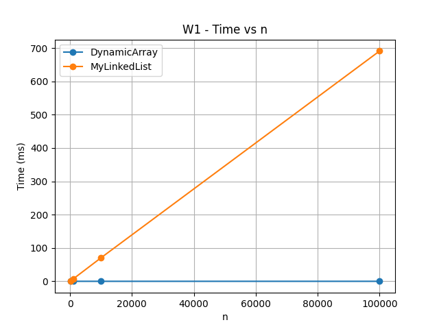
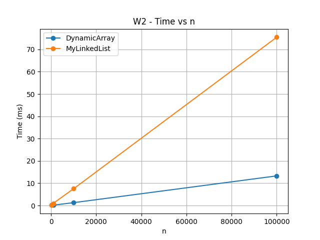
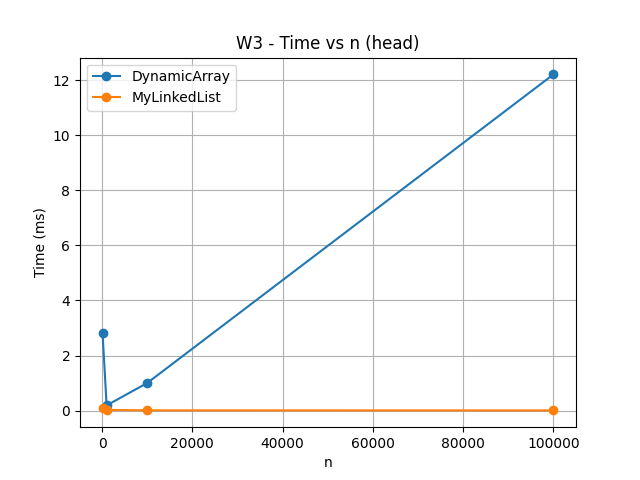
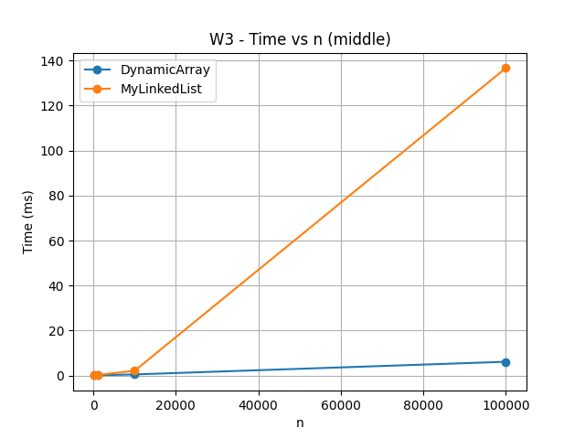
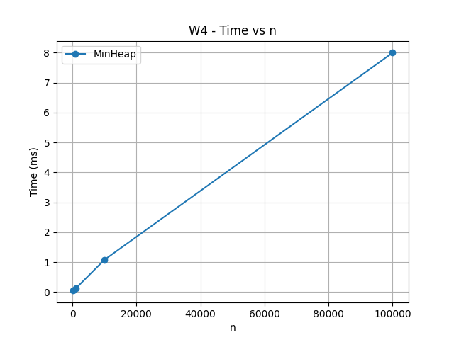

# Assignment 2 – Data Structures

**Course:** Design and Analysis of Algorithms  
**Student:** Amina Satybaldy  
**Assignment:** Assignment 2 – Data Structures

## 1. Introduction

The purpose of this assignment is to implement and compare three data structures from scratch: DynamicArray, MyLinkedList, and MinHeap.

The structures store primitive `int` values. DynamicArray and MinHeap use arrays, while MyLinkedList uses nodes and references. The implementation also contains counters for steps, moves, and comparisons.

The structures were tested using JUnit 5 and evaluated using four benchmark workloads with different input sizes.

---

## 2. Implemented Data Structures

### DynamicArray

DynamicArray stores elements inside an `int[]`. When the array becomes full, its capacity is doubled. It supports:

- `add(x)`
- `add(index, x)`
- `remove(index)`
- `get(index)`
- `contains(x)`

Random access is fast because an array can directly access an element by its index.

### MyLinkedList

MyLinkedList is implemented using linked nodes. Each node stores an integer value and a reference to the next node.

It supports the same operations as DynamicArray:

- `add(x)`
- `add(index, x)`
- `remove(index)`
- `get(index)`
- `contains(x)`

A tail reference is used to make insertion at the end efficient.

### MinHeap

MinHeap is implemented using an array-based binary heap. It supports:

- `insert(x)`
- `peekMin()`
- `extractMin()`

After insertion, bubble-up restores the heap property. After extracting the minimum value, bubble-down restores the heap property.

---

## 3. Complexity Analysis

| Structure | Operation | Best Case | Average Case | Worst Case | Auxiliary Space |
|---|---|---|---|---|---|
| DynamicArray | add(x) | Θ(1) | Θ(1) amortized | Θ(n) | Θ(n) |
| DynamicArray | add(index, x) | Θ(1) | Θ(n) | Θ(n) | Θ(n) |
| DynamicArray | remove(index) | Θ(1) | Θ(n) | Θ(n) | Θ(1) |
| DynamicArray | get(index) | Θ(1) | Θ(1) | Θ(1) | Θ(1) |
| DynamicArray | contains(x) | Θ(1) | Θ(n) | Θ(n) | Θ(1) |
| MyLinkedList | add(x) | Θ(1) | Θ(1) | Θ(1) | Θ(1) |
| MyLinkedList | add(index, x) | Θ(1) | Θ(n) | Θ(n) | Θ(1) |
| MyLinkedList | remove(index) | Θ(1) | Θ(n) | Θ(n) | Θ(1) |
| MyLinkedList | get(index) | Θ(1) | Θ(n) | Θ(n) | Θ(1) |
| MyLinkedList | contains(x) | Θ(1) | Θ(n) | Θ(n) | Θ(1) |
| MinHeap | insert(x) | Θ(1) | O(log n) | Θ(log n) | Θ(1) |
| MinHeap | peekMin() | Θ(1) | Θ(1) | Θ(1) | Θ(1) |
| MinHeap | extractMin() | Θ(1) | O(log n) | Θ(log n) | Θ(1) |

DynamicArray `get()` is constant time because the element is accessed directly by index. Insertion and removal may require shifting elements.

MyLinkedList must traverse nodes to reach an arbitrary index, so indexed operations usually require linear time. Operations at the head are constant time.

MinHeap uses a binary tree stored inside an array. Bubble-up and bubble-down operate along the height of the heap, which is logarithmic.

---

## 4. Loop Invariant Proof 1 – DynamicArray contains()

### Invariant

Before every iteration of the loop, all elements before index `i` have already been checked and none of them is equal to the searched value.

### Initialization

Before the first iteration, `i = 0`. No elements have been checked yet, so the invariant is true.

### Maintenance

During each iteration, `data[i]` is compared with the searched value. If it is equal, the method returns `true`. Otherwise, `i` is increased and all elements before the new value of `i` have been checked.

Therefore, the invariant remains true.

### Termination

The loop terminates when either the value is found or `i == size`.

If `i == size`, every element in the array has been checked and none is equal to the searched value.

### Conclusion

Therefore, `contains()` correctly returns `true` when the value exists and `false` when it does not exist.

---

## 5. Loop Invariant Proof 2 – MinHeap Bubble-Down

### Invariant

Before every iteration of bubble-down, the heap property is valid everywhere except possibly between the element at the current index and its children.

### Initialization

After `extractMin()`, the last element is moved to the root. The two subtrees below the root are still valid heaps, so only the new root may violate the heap property.

### Maintenance

The current element is compared with its children. If one of the children is smaller, the current element is swapped with the smallest child.

After the swap, the heap property is restored at the previous position. A possible violation can only remain at the new current position.

Therefore, the invariant is maintained.

### Termination

The loop stops when the current element has no smaller child or reaches a leaf.

At this point there is no remaining violation of the heap property.

### Conclusion

Therefore, bubble-down correctly restores the MinHeap property after `extractMin()`.

---

## 6. Benchmark

The benchmark was executed for the following sizes:

- 100
- 1,000
- 10,000
- 100,000

The random input data was generated using `Random(42)` to make the experiment reproducible.

The following workloads were tested:

- **W1 – Random Access:** 10,000 random `get(index)` operations.
- **W2 – Search:** 1,000 `contains(x)` operations.
- **W3 – Insert & Remove:** operations at the head and middle.
- **W4 – Priority Processing:** insert values into MinHeap and extract all values in non-decreasing order.

The benchmark results are stored in `results/results.csv`.

---

## 7. Benchmark Plots

### W1 – Random Access

The results show the difference between direct array access and linked-list traversal.

### W2 – Search

Both structures use linear search, but their real execution time can differ because their memory layouts are different.

### W3 – Head Operations

Head insertion and removal demonstrate an important advantage of linked structures because they do not need to shift all following elements.

### W3 – Middle Operations

Middle operations require either shifting array elements or traversing linked-list nodes.

### W4 – Priority Processing

MinHeap efficiently processes elements according to their priority while maintaining the heap property.

---

## 8. Discussion

DynamicArray is very efficient for random access because an element can be found directly using its index. MyLinkedList must follow references from one node to another, so random access becomes slower as the index increases. Arrays also have good spatial locality because their values are stored next to each other in memory. This allows the CPU cache to load several nearby values efficiently. Linked-list nodes can be located in different memory locations. Following references between these nodes is called pointer chasing and can cause more cache misses. Node objects also require additional memory for references and object headers. Garbage collection can create additional overhead when many node objects are created. Therefore, two operations with similar Big-O complexity can still have noticeably different real execution times. DynamicArray is usually a better choice when frequent indexed access is required. MyLinkedList can be useful when frequent insertions or removals are performed at the beginning of the structure. However, accessing the middle of a linked list requires traversal. MinHeap is a better choice when the smallest-priority element must be accessed and removed repeatedly. Its root contains the minimum value and `peekMin()` is constant time. Insert and extract operations require at most logarithmic heap adjustment. The benchmark therefore demonstrates that asymptotic complexity is important, but memory layout and hardware behavior also affect actual performance.

---

## 9. Testing

JUnit 5 was used to test the implementations.

The tests include:

- insertion
- removal
- indexed access
- search
- duplicate values
- invalid indexes
- empty heap operations
- sorted MinHeap extraction

All **17 tests passed successfully**.

---

## 10. Conclusion

In this assignment, DynamicArray, MyLinkedList, and MinHeap were implemented from scratch. Their correctness was checked using JUnit tests, while their performance was evaluated using benchmark workloads and operation counters.

The results demonstrate that choosing a data structure depends not only on Big-O complexity but also on the type of workload and the way data is represented in memory.